

# 🌿 Mission City Chakra Map

**A collaborative map of zero-waste restaurants, schools, grocery stores and recycling initiatives across Pune**

 

 

 

 

> **Notice**: Source code is private. Architecture and design are documented below.

---

##  Overview

Mission City Chakra Map is an interactive, crowdsourced web application created to locate and celebrate sustainable, zero-waste initiatives across Pune. Designed for both everyday residents and local contributors, it surfaces a verified directory of restaurants, schools, grocery outlets, and recycling centers. By coupling public submissions with an authenticated administrative moderation barrier, the project promotes responsible living while safeguarding data integrity.

| Dimension | Specification |
| :--- | :--- |
| **Type** | Web Application (Public Interactive Map & Moderation Console) |
| **Status** | Live |
| **Role** | Dipesh Karalkar, Soham Pawar |
| **Duration** | 2025 / 2026 |
| **Stack Summary** | HTML5, CSS3, JavaScript, Node.js, Express.js, PostgreSQL, Google Workspace, Vercel, Render |

---

##  Features

| Marker | Feature | Description |
| :---: | :--- | :--- |
|  | **Community Submissions** | Users click "Add Place" and submit a location through a Google Form. |
|  | **Categorised Map Layers** | Places grouped by type (restaurants, schools, grocery stores, recycling initiatives). |
|  | **Search Filters** | Users can search and filter places on the map. |
|  | **Ratings** | Places can be rated. |
|  | **Admin Moderation Workflow** | Admins sign in with Google OAuth 2.0, review each submission, approve valid entries and reject spam or invalid ones. |
|  | **Verified-Only Public Data** | Only approved entries appear on the live map. |

### Feature Visuals

####  Community Submissions
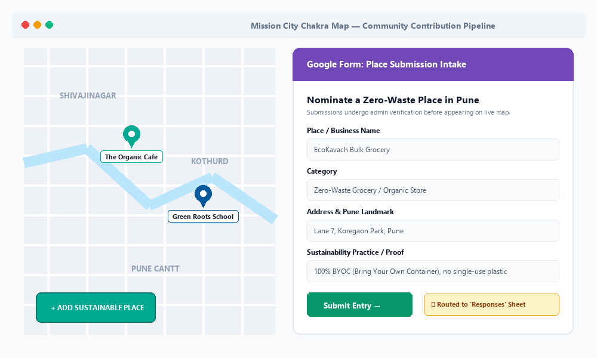
*Figure 1: Community crowdsourcing entry point routing users to the structured Google Form intake.*

####  Categorised Map Layers
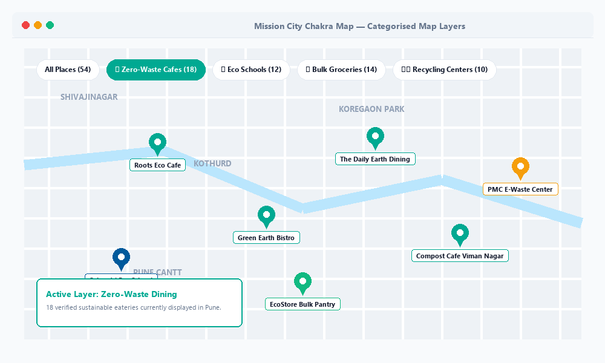
*Figure 2: Categorical map visualization organizing zero-waste restaurants, schools, grocers, and recycling centers.*

####  Search Filters
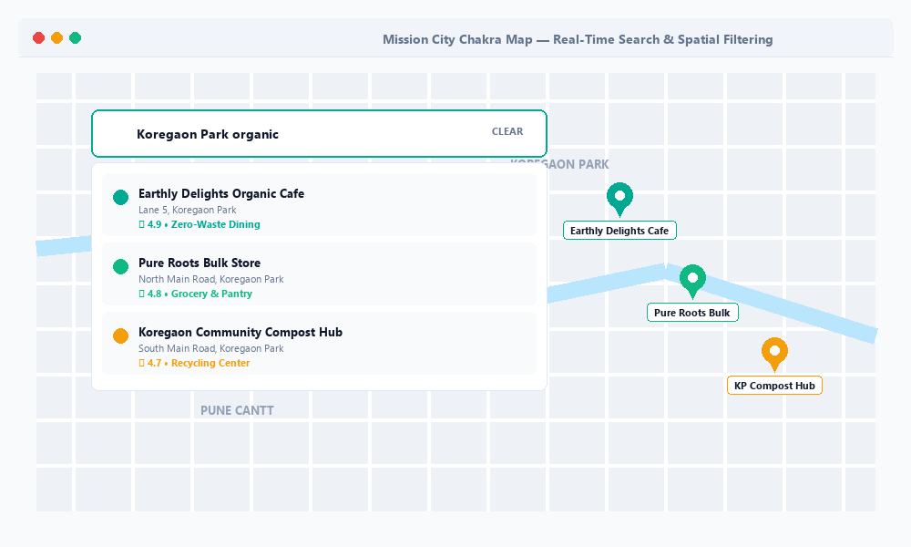
*Figure 3: Interactive filtering interface enabling location discovery by category and keyword search.*

####  Ratings
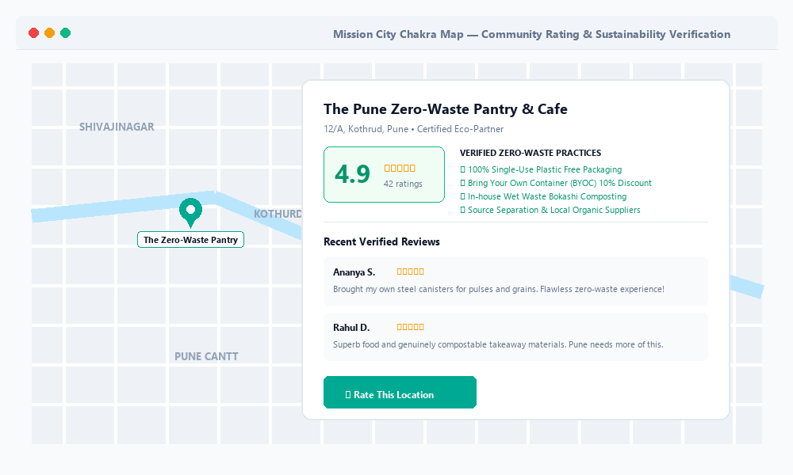
*Figure 4: Community rating display allowing users to evaluate and recognize sustainable establishments.*

####  Admin Moderation Workflow
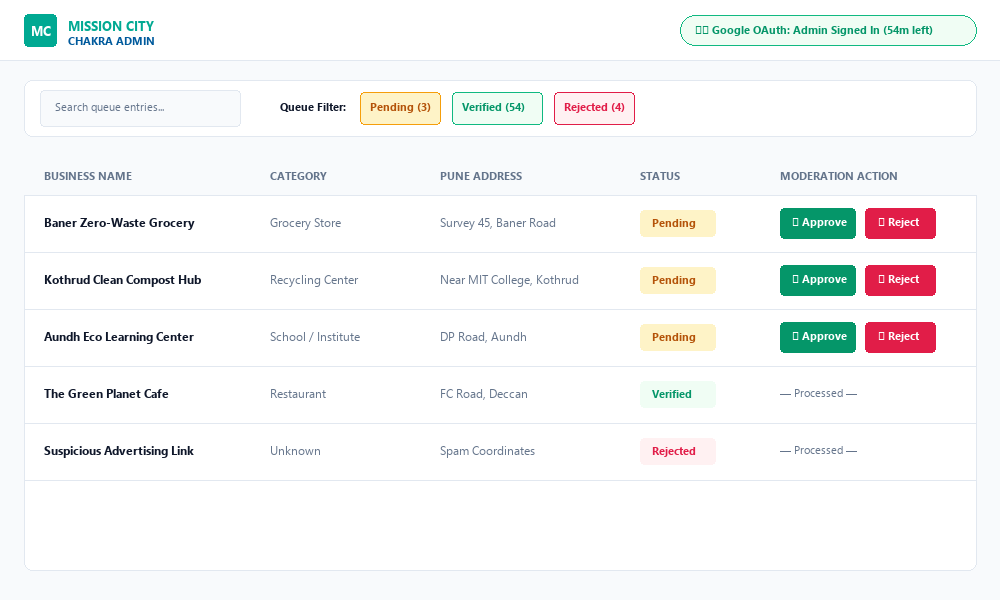
*Figure 5: Protected administrative dashboard with Google OAuth 2.0 authentication and review actions.*

####  Verified-Only Public Data
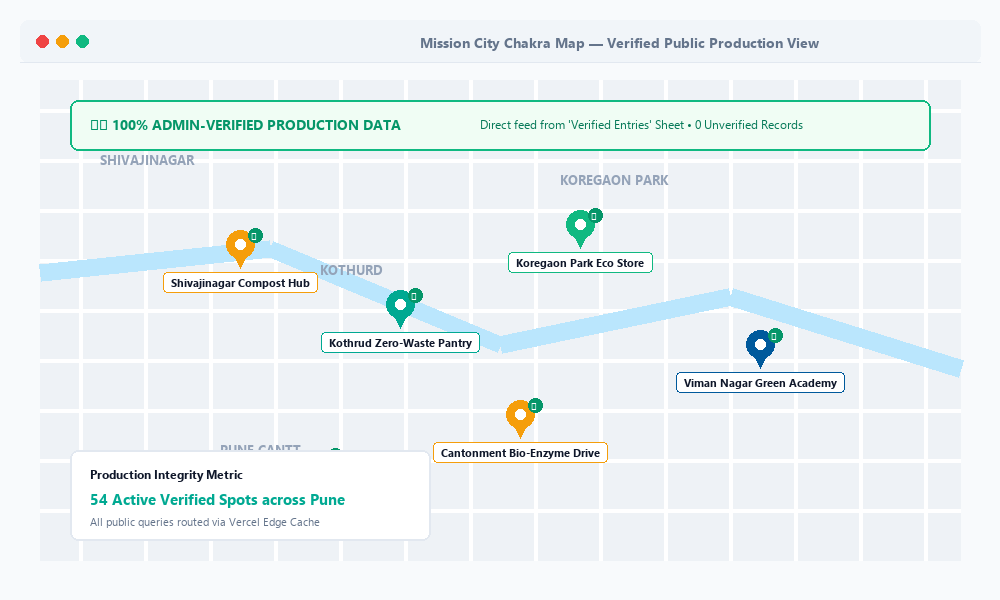
*Figure 6: Public map rendering exclusively sanitised and verified production datasets.*

---

##  Architecture

The Mission City Chakra platform is engineered as an air-gapped, two-tier system: a public-facing read map hosted on Vercel and an authenticated moderation backend hosted on Render, bridged by Google Forms and Google Sheets.

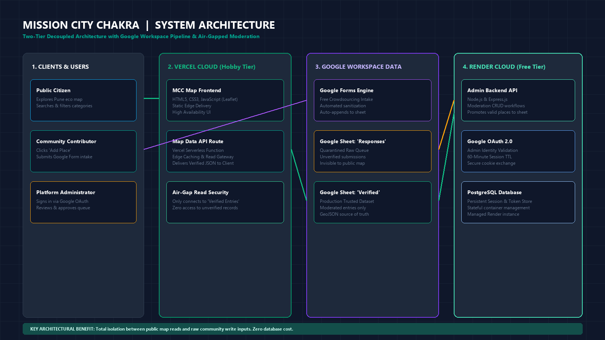
*Figure 7: Master system architecture diagram exported from the technical design documentation.*

### a) System Context Diagram

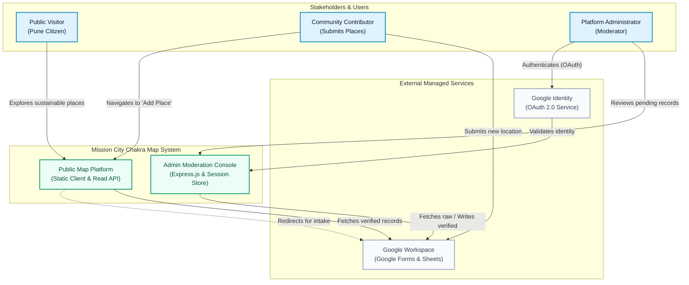
*System Context Diagram: Interactions between public visitors, contributors, moderators, and cloud services.*

### b) High-Level Architecture Diagram

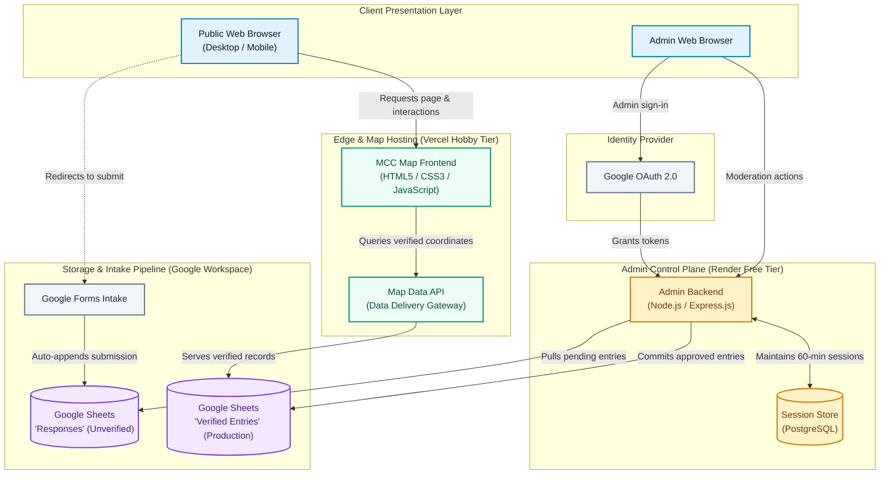
*High-Level Architecture Diagram: Layered decomposition of clients, Vercel edge delivery, Render backend, and Google data pipelines.*

### c) Request Lifecycle Sequence Diagram

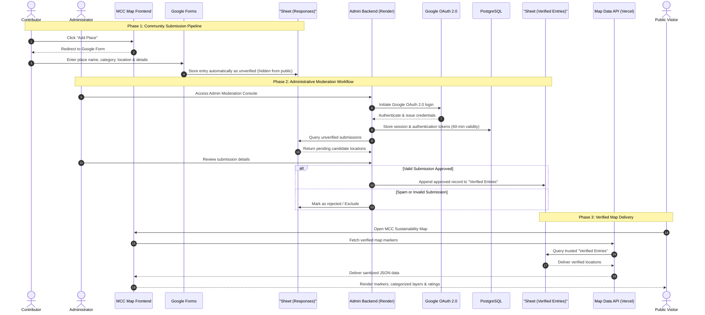
*Request Lifecycle Sequence Diagram: Step-by-step path from contributor submission through OAuth moderation to public map rendering.*

### d) Data Model / ER Diagram

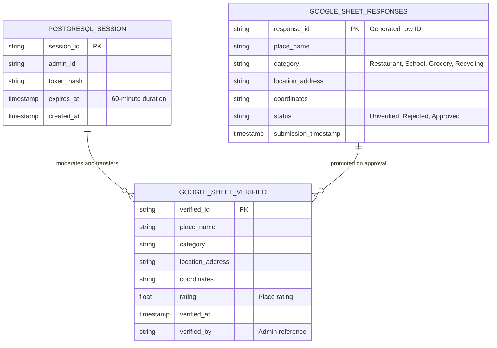
*Data Model Diagram: Relational mapping between PostgreSQL session tokens, unverified Google Sheet submissions, and production verified records.*

### e) Deployment and Infrastructure Flow Diagram

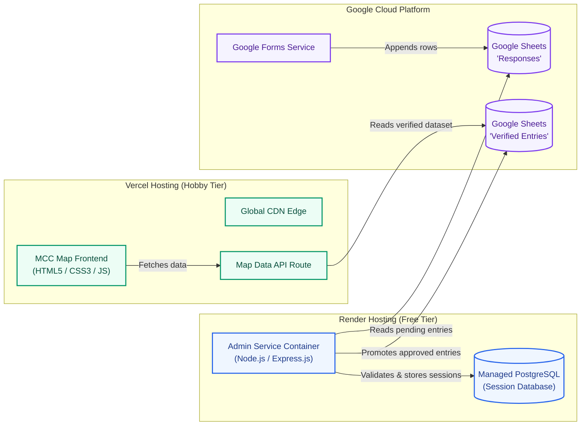
*Deployment Topology Diagram: Distribution of services across Vercel edge delivery, Render container hosting, and Google Cloud services.*

### f) User Journey Flowchart

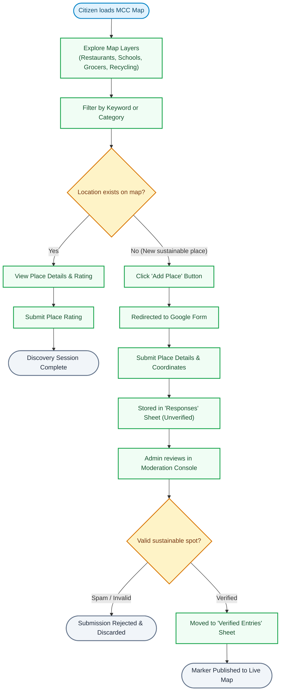
*User Journey Flowchart: Paths for viewers exploring verified places and contributors submitting new initiatives for admin review.*

---

##  Tech Stack

| Layer | Technology | Purpose | Badge |
| :--- | :--- | :--- | :--- |
| **Frontend Structure** | HTML5 | Page structure of the MCC map |  |
| **Frontend Styling** | CSS3 | Styling and responsive layout |  |
| **Frontend Logic** | JavaScript | Map interaction and frontend logic |  |
| **Map Library** | OpenStreetMap | Map tiles |  |
| **Backend Runtime** | Node.js | Backend runtime environment for the admin console |  |
| **API Framework** | Express.js | Server-side APIs and admin moderation workflows |  |
| **Session Database** | PostgreSQL | Secure storage of authentication sessions and tokens |  |
| **Submission Form** | Google Forms | Collects location details from users |  |
| **Data Store** | Google Sheets | "Responses" holds unverified data; "Verified Entries" holds production data |  |
| **Authentication** | Google OAuth 2.0 | Admin login; secure sign-in with sessions valid for 60 minutes |  |
| **Data Delivery API** | Map data API | Serves verified entries from "Verified Entries" sheet to live map |  |
| **Frontend/API Host** | Vercel (Hobby tier) | Hosts the map data API and the live map |  |
| **Backend/DB Host** | Render (free tier) | Hosts the admin backend and the PostgreSQL database |  |

### Why These Choices

The system prioritises rapid community intake and operational simplicity over monolithic complexity. By pairing Google Forms and Google Sheets as a headless ingestion layer, crowdsourced entries are collected with zero upfront form development and zero hosting costs. Splitting hosting between Vercel (static map client and read API edge) and Render (stateful Node.js admin runtime and PostgreSQL) separates public read traffic from administrative write workloads. Google OAuth 2.0 paired with PostgreSQL token persistence enforces centralized admin identity without requiring the risk or maintenance of custom password authentication.

---

##  Key Engineering Decisions

<strong>Decision 1: Google Forms & Sheets as a Headless Crowdsourcing Pipeline</strong>

- **Problem**: Needed a reliable, frictionless data submission pipeline for community members without spending cycles developing custom authenticated form pages, input sanitation logic, and storage schemas.
- **Options Considered**: Building a custom in-app submission form connected to an API endpoint vs. delegating ingestion to Google Forms linked to Google Sheets.
- **Decision**: Adopted Google Forms for submission intake, writing incoming submissions into a raw "Responses" Google Sheet.
- **Result**: Immediate zero-maintenance submission interface with zero database write load on the public map infrastructure.

<strong>Decision 2: Two-Sheet Isolation for Moderation Integrity</strong>

- **Problem**: Direct-to-production crowdsourcing invites spam, offensive content, and inaccurate map markers that degrade platform trustworthiness.
- **Options Considered**: Immediate public publishing with post-hoc community reporting vs. strict two-tier data segregation with mandatory admin sign-off.
- **Decision**: Implemented a two-sheet data boundary where unverified submissions remain isolated in "Responses", and only reviewed and approved records are moved into "Verified Entries".
- **Result**: The public map API queries only "Verified Entries", guaranteeing 100% human-verified live data and complete isolation from unverified entries.

<strong>Decision 3: Delegated Google OAuth 2.0 Authentication with PostgreSQL Session Storage</strong>

- **Problem**: Ensuring secure access to the admin moderation backend without storing or managing administrator passwords and credentials.
- **Options Considered**: Custom credential authentication (username/password with bcrypt and JWT) vs. federated Google OAuth 2.0 with a persistent session store.
- **Decision**: Integrated Google OAuth 2.0 for administrative authentication, issuing 60-minute time-boxed sessions stored and validated inside PostgreSQL.
- **Result**: Zero credential liability, strict time-limited administrative sessions, and seamless revocation workflows.

<strong>Decision 4: Multi-Cloud Tiered Free-Tier Architecture (Vercel + Render)</strong>

- **Problem**: Deploying both a high-availability public map and a stateful administrative control plane within zero operational infrastructure budgets.
- **Options Considered**: Running all workloads on a single free virtual machine vs. decoupling static public delivery (Vercel) from stateful moderation services (Render).
- **Decision**: Deployed the public map frontend and read API on Vercel (Hobby tier), while placing the Node.js/Express.js admin backend and PostgreSQL database on Render (free tier).
- **Result**: Fast, globally cached edge delivery for public viewers, alongside dedicated containerized execution for admin moderation, accepting backend cold starts as a calculated trade-off.

---

##  Security and Performance

### Authentication & Authorization
Administrative operations are guarded by Google OAuth 2.0. Sessions and auth tokens are persisted in PostgreSQL with an enforced **60-minute time-to-live (TTL)**. Unauthorized requests to moderation endpoints are rejected at the Express.js middleware boundary.

### Data Protection & Boundary Isolation
The public map has no read or write access to unverified submissions. The submission pipeline enforces an air gap: user inputs are captured via Google Forms into the "Responses" sheet and remain quarantined until an administrator validates the record and manually commits it to the "Verified Entries" sheet.

### Caching, Edge Delivery & Optimization
The public map interface and the read-only Map Data API reside on Vercel's global edge network, minimizing latency for Pune residents querying map pins and categorical layers.

### Scaling & Infrastructure Trade-offs
The infrastructure operates on free tiers (Vercel Hobby and Render Free tier). Under this architecture:
- Public map viewing remains consistently responsive via Vercel edge delivery.
- The Render administrative backend experiences occasional container spin-down after periods of inactivity, resulting in a brief cold start upon initial admin login.

| Metric | Target / Observed |
| :--- | :--- |
| **Admin Session Validity** | 60 minutes |

---

### Operational Trade-off: Free-Tier Cold Starts
A known operational trade-off of the Render free-tier environment is container idling. After periods of inactivity, the admin service spins down, resulting in a cold start latency when an administrator initially accesses the moderation dashboard. Because moderation is an asynchronous internal task rather than a user-blocking flow, this latency was accepted to keep running costs at zero while maintaining full database-backed session security.

---

##  Roadmap

- [x] Public MCC map interface with responsive HTML5, CSS3, and JavaScript
- [x] Categorised map layers for restaurants, schools, grocers, and recycling centers
- [x] Search and filtering interface for Pune locations
- [x] Community ratings system for sustainable establishments
- [x] "Add Place" community crowdsourcing workflow via Google Forms
- [x] Dual-dataset pipeline isolating unverified "Responses" from "Verified Entries"
- [x] Node.js & Express.js moderation backend on Render
- [x] Google OAuth 2.0 authentication for administrators
- [x] PostgreSQL session and token store with 60-minute automated expiry
- [x] Public Map Data API deployment on Vercel

---

##  Access and Contact

### Code Access
> **Code Access Policy**: The source code for Mission City Chakra Map is maintained in a private repository to protect administrative workflow logic and backend infrastructure configurations. Full code walkthroughs or temporary repository access can be provided upon request for technical interviews, recruiters, and engineering reviews.

### Engineering Team

| Contact Channel | Dipesh Karalkar | Soham Pawar |
| :--- | :--- | :--- |
| **LinkedIn** | https://www.linkedin.com/in/dipesh-karalkar-2552b5341/ | https://www.linkedin.com/in/soham-pawar-99717b346/ |
| **Email** | atharvkaralkar07@gmail.com | sohampawar261933@gmail.com |

---

##  Missing Info to Complete This README

The following items were provided as dashes (`—`) and require population when details become available:

1. **Live Site URL**: Direct link to the public production website.
2. **Project Duration**: Specific build duration / calendar months in 2026.
3. **Frontend Map Library**: Library used for map rendering (e.g., Leaflet.js, Mapbox GL JS, Google Maps API, or OpenLayers).
4. **CI/CD / DevOps**: Build scripts, continuous integration tools, or automated deployment triggers.
5. **Monitoring & Analytics**: Telemetry or visitor tracking tools (e.g., Google Analytics, Vercel Analytics, UptimeRobot).
6. **Other Developer Tools**: Linter, formatter, or package managers utilized.
7. **Biggest Technical Challenge**: Specific architectural challenge, implementation solution, and takeaway.
8. **Performance Metrics**: Concrete benchmarks for page load time, monthly active contributors, and uptime.
9. **Future Roadmap Items**: Specific upcoming milestones or planned roadmap features.
10. **Contact Links**: LinkedIn profiles, portfolio URLs, and direct contact email addresses for both Dipesh Karalkar and Soham Pawar.
